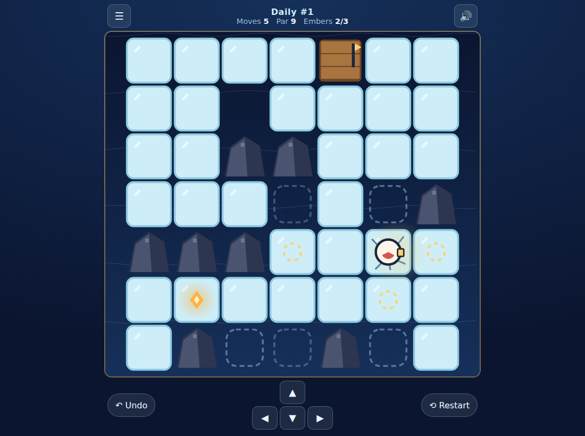

# Floeline

**A daily sliding-ice puzzle where every floe you stop on melts behind you.**

You carry a lantern across a frozen lake at dusk. When you push in a direction, you slide until a rock, open water or the edge of the board stops you. The floe you stop on cracks, and it melts as soon as you leave it. Every move therefore changes the board for good: it opens new stopping points and closes off old routes. Collect every ember, reach the dock, and try to match the solver's par.

- **Daily puzzle:** one board per local calendar date, the same for everyone. Puzzle #1 is 2026-11-24. You get a spoiler-free share line, and your streak is stored locally.
- **Practice:** unlimited Easy (6×6), Medium (7×7) and Hard (8×8) boards. Every board is generated from a seed and checked by a solver.
- Runs in any modern browser on desktop or mobile. No account, no network calls, no tracking.



## Prerequisites

- Node.js 24 (tested with 24.14.0) and npm 11.
- For the end-to-end tests only: Playwright's Chromium **v1248**, which `@playwright/test@1.64.1` uses. On the original WSL machine it was already in `~/.cache/ms-playwright`. On a new machine, run `npx playwright install chromium`; that downloads into your user cache.
- `python3` is used only by `npm run package:itch`, which calls the standard-library `zipfile` module.

## Setup and run

```bash
npm ci                 # install the pinned dev dependencies (there are no runtime dependencies)
npm run dev            # dev server at http://localhost:5173
npm run build          # production build into dist/
npm run preview        # serve the built game at http://localhost:4173
npm run package:itch   # release/floeline-web.zip, ready for itch.io (index.html at the zip root)
```

**WSL:** WSL2 forwards `localhost` to Windows. On the development machine, with `npm run preview` running in WSL, I confirmed that `curl.exe http://localhost:4173/` run from Windows returns HTTP 200. So open http://localhost:5173 (dev) or http://localhost:4173 (preview) in your Windows browser. If that fails on your setup, run `npm run dev -- --host` and use the WSL IP address that Vite prints.

## Test and benchmark

```bash
npm run typecheck      # strict TypeScript, no emit
npm test               # unit tests (Vitest), including 365 consecutive daily puzzles checked for solvability and par band
npm run test:e2e       # builds, serves dist/ from a subpath like itch.io does, then plays the game in headless Chromium
npm run check          # all of the above
npm run bench          # Node benchmark for puzzle generation (365 seeds per difficulty)
npm run build && npm run bench:browser -- <label>   # browser benchmark, writes docs/benchmarks/<label>.json
```

The e2e tests (13 of them) serve the production build from the subpath `/play/floeline/`, as itch.io does. They load it as a top-level page; I did not test it inside an iframe. The tests press real keys, tap the on-screen pad, swipe with a mouse and click beside the player. They solve a daily puzzle, undo, get stranded on purpose, and restart. They also check that results and settings persist, that **Copy result** puts the share line on the clipboard, and that the select-text fallback works when the clipboard API is denied. Screenshots are saved to `docs/screenshots/`.

### Self-review and pre-push hook

```bash
npm run review          # staged changes: static checks + typecheck + unit tests
npm run review:branch   # every change on this branch vs its base (origin/HEAD, master or main)
npm run review:full     # branch review plus build and e2e tests
```

`scripts/review.sh` **blocks** on: likely secrets (AWS keys, private keys, GitHub/Slack/`sk-` tokens, hard-coded `password=`/`token=` values), forbidden files (`.env`, `credentials.json`, `.claude/settings.local.json`, keys), committed build output, conflict markers, `test.only`, `debugger`, files over 5 MB, and typecheck or test failures. It **warns** on `console.log` in `src/`, new TODO/FIXME comments, and files over 1 MB.

The pre-push hook lives in `.githooks/pre-push`. `npm ci` and `npm install` enable it by setting `git config core.hooksPath .githooks` through the `prepare` script. The hook runs `scripts/pre-push-check.sh`, which:

- rejects branch names that don't start with `feature/`, `fix/` or `chore/`, including any `claude/` branch;
- allows `main`/`master` with a notice;
- skips pushes that only delete branches;
- otherwise runs `npm run review:full`.

In an emergency, bypass it with `git push --no-verify`.

### Manual check (about 3 minutes; covers what automation here can't)

1. In WSL, run `npm run build && npm run preview`, then open http://localhost:4173 in a Windows browser (Chrome, Edge or Firefox).
2. Close How to play and click **Play today's puzzle**. Slide once: you should **hear** a whoosh and a soft thud, and the floe you left should melt. Turn on the 🔊 button first if needed.
3. Solve the puzzle. If you get stuck, landing hints and Undo help. You should hear the **win chime**. Click **Copy result** and paste into a text editor to check the three-line share text.
4. Reload: the title should show "Replay today's #N", with *played 1* and *streak 1*.
5. On a phone or a touch screen, open the same URL (run `npm run preview -- --host` and use your PC's LAN IP), then **swipe** on the board to slide.

## Controls

| Action | Keyboard | Touch / mouse |
|---|---|---|
| Slide | Arrow keys or WASD | Swipe on the board, tap the board on the side you want to go, or use the on-screen pad |
| Undo | Z, U or Backspace | ↶ Undo |
| Restart | R | ⟲ Restart |
| Toggle sound | M | 🔊 button |
| Menu / close dialog | Esc | ☰ button |

## Rules

1. You slide until the next cell is a rock, water (including melted floes) or the edge. Sliding onto the dock stops you there.
2. When you leave a floe you had stopped on, it melts into water. The dock never melts.
3. Passing over an ember collects it. You win by standing on the dock with every ember collected.
4. If no direction moves you, you're **stranded**. Undo or restart; neither has a limit. The daily score is the number of moves on the board when you finish, and the share line also records your undos and restarts.

## Accessibility

- Keyboard-only play, visible focus rings, and buttons at least 44 px tall.
- Tiles differ by shape as well as colour: jagged rocks, a diamond ember, a plank dock with a flag, a cracked floe under the player.
- **Reduce motion** setting, which defaults to the OS `prefers-reduced-motion` value. Optional landing hints (dashed rings show where each direction would stop you). Sound toggle.
- Move, par and ember counts sit in an `aria-live` region.

## Project layout

```
src/core/      pure game logic: rules, BFS solver, seeded generator, daily numbering, session, share text
src/game/      browser layer: canvas renderer, app controller, generation Web Worker + fallback client, WebAudio SFX, localStorage
tests/unit/    Vitest unit tests, including a reference solver used as an equivalence oracle
tests/e2e/     Playwright end-to-end tests
scripts/       benchmarks, subpath static server, itch.io packager
docs/          concept/validation record, screenshots, benchmark results
```

## Assets and licences

All visuals are drawn in code with Canvas 2D, and all sounds are synthesized at runtime with WebAudio. There are no image, font or audio files apart from a hand-written `favicon.svg`. Everything in this repository is original and released under the MIT licence (see `LICENSE`). Development dependencies are installed through npm under their own licences and are not shipped in the build.

## Known limitations

- **Daily puzzles depend on local date.** Puzzles are keyed to the player's local date, so players in different timezones get a new board at different times.
- **Stats live in one browser.** They are kept in `localStorage`, so there is no cross-device sync. If storage is blocked, the game still plays but nothing is saved.
- **Hard boards can take a moment to appear on slow devices.** Boards are generated in a Web Worker, so the page keeps animating and shows a "Freezing the lake…" indicator; the Hard worst case still takes about 0.5 s to arrive on a slow device. Without Worker support the game generates on the main thread instead (see `PLAN.md`).
- **Puzzles have not been playtested by humans.** Difficulty is tuned only by solver metrics (a par band and a minimum number of dead ends).
- **Sound was not verified by ear.** I can't hear audio from WSL. The WebAudio code runs without errors in headless Chromium.
- **Visuals were checked only in headless Chromium.** I have not checked them in Firefox or Safari.
